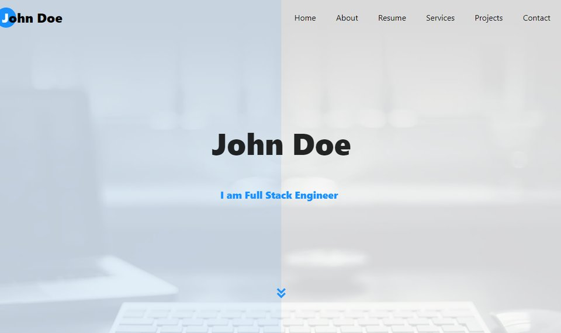
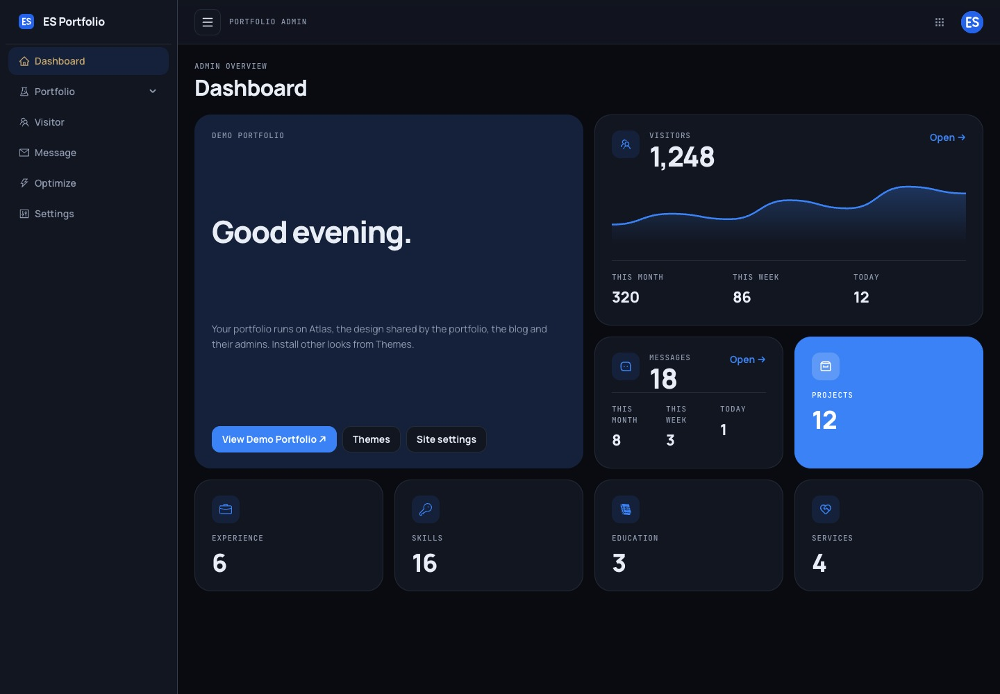
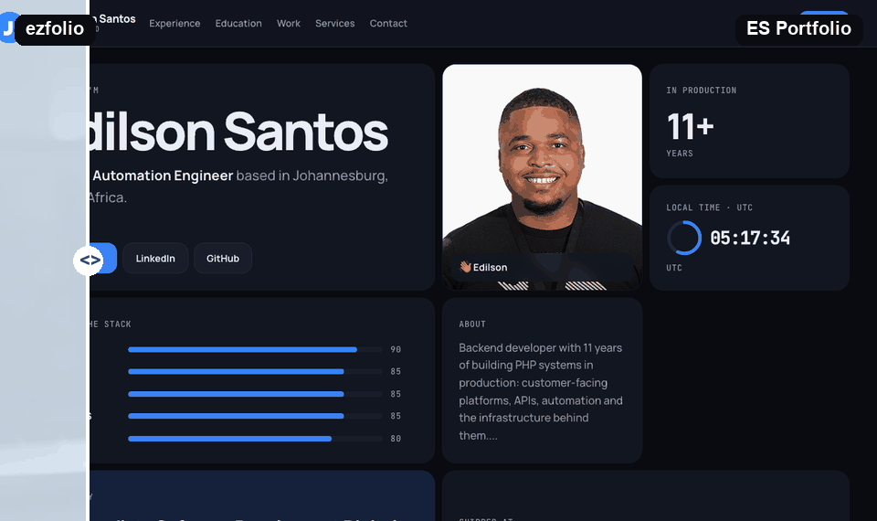

# ES Portfolio

<table>
  <tr>
    <th align="center"><a href="https://github.com/arifszn/ezfolio">ezfolio</a> (original)</th>
    <th align="center">ES Portfolio (ours)</th>
  </tr>
  <tr>
    <td></td>
    <td></td>
  </tr>
  <tr>
    <td colspan="2" align="center"><br>
    <sub>Admin dashboard comparison: ezfolio on the left, ES Portfolio on the right. Before: <a href="https://arifszn.github.io/ezfolio/img/assets/screenshots/dashboard.png">upstream ezfolio dashboard screenshot</a> (MIT licensed). After: the local ES Portfolio dashboard rendered with demo data.</sub></td>
  </tr>
</table>

A self-hosted developer portfolio with a dark Atlas bento design and a React content admin panel.
Part of the ES apps family alongside ES Blog, ES Store (the ES Marketplace) and ES Journal.

> **Origin:** ES Portfolio is a maintained fork of [ezfolio](https://github.com/arifszn/ezfolio)
> by [Ariful Alam (arifszn)](https://github.com/arifszn), licensed under MIT. The original portfolio
> CMS, Laravel API, React admin and Blade templates remain the foundation; upstream copyright
> is preserved in [LICENSE](LICENSE).

## ES Portfolio vs ezfolio

The original column describes upstream's [README](https://github.com/arifszn/ezfolio#readme),
[Composer manifest](https://github.com/arifszn/ezfolio/blob/main/composer.json) and
[frontend manifest](https://github.com/arifszn/ezfolio/blob/main/package.json), not every ezfolio fork.
The ES Portfolio column reflects this repository's current code and development history.

| Area | ezfolio (original) | ES Portfolio |
|---|---|---|
| Backend | Laravel 8; PHP `^7.3` or `^8.0` | Laravel 12; PHP `^8.2`, upgraded incrementally through Laravel 10 and 11 |
| React | React 17 | React 19 with the current root API |
| Admin UI libraries | Ant Design 4 and Pro Layout 6 | Ant Design 6 and Pro Layout 7 |
| Routing and state | React Router 5, Redux 4, React Redux 7 | React Router 7, Redux 5, React Redux 9 and styled-components 6 |
| Asset toolchain | Laravel Mix 6 / webpack | Vite 8; Node 20.20.x and npm 10 runtime constraints |
| Public design | Multiple bundled templates: Azure, Rigel, Vega and Procyon | Atlas is the built-in default: flatter, tighter bento hero and bento experience, education, work and service sections |
| Atlas live tiles | No Atlas template | Local-time clock with seconds ring, availability tile, project counts, animated skill meters and company ticker; environment-configurable availability/timezone |
| Appearance and motion | Template/theme colour customization | Dark-only public Atlas and admin, no light/dark toggle; reduced-motion handling in Atlas |
| Admin layout | Minimal Ant Design portfolio CMS interface | Atlas/Manrope styling, ES mark identity, persistent collapsible sidebar and a bento dashboard with welcome, activity and content-count tiles |
| Visitor analytics UI | Visitor and location tracking already provided | Redesigned KPIs, daily new/returning chart, top locations and readable device/browser/platform donuts |
| Account portraits | Uploaded images | Gravatar for the admin menu and public portrait fallback when no portrait is uploaded |
| SSO | Local JWT/password authentication | Optional Logto integration for DataSparkLab SSO using OIDC authorization code + PKCE; state, nonce, issuer, audience and expiry checks; verified email must match an existing admin |
| Sign-in experience | Application password form | With SSO configured, admin login redirects directly to Logto with dark sign-in styling; password UI remains available on non-SSO installs |
| Shared account state | No ES apps integration | Signed-in admin/account menu on public pages; shared Logto sign-in and an `es-signout` marker that invalidates stale local admin tokens across ES apps |
| App navigation | Standalone portfolio | ES apps launcher on public/admin pages, shared masthead/footer styling, ES Blog and ES Store links, and an optional ES Journal dashboard link |
| Theme distribution | Templates bundled in the portfolio | Original templates and Orion-family variants distributed through ES Marketplace; unknown/removed installed themes fall back to Atlas |
| Theme installation | Bundled template selection | Admin → Portfolio → Themes installs from the store catalogue or an uploaded ZIP; persistent `storage/app/themes/<id>/` installs |
| Theme package trust | No signed marketplace installer | Ed25519-signed manifests, per-file SHA-256 checks, app/version constraints, allowed-path and size/file-count limits; unsigned packages rejected by default |
| Operational security | Public log viewer and `/optimize`; non-production arbitrary-command route | Log viewer removed, arbitrary-command route absent, guarded operational web routes and authenticated admin API optimization; native Laravel CORS |
| Health monitoring | No equivalent health/readiness routes | `/health` reports app/version status; `/ready` checks the DB and returns 503 when unavailable |
| Database/startup safety | Standard migrations and seeding setup | Database readiness probe, additive indexes and JSON shadow columns; production startup preserves JWT secrets and does not reseed or fresh-reset existing data |
| Media handling | Portfolio media uploads | Public/S3-compatible storage selection, normalized uploaded media URLs and startup creation of upload directories |
| Docker | Laravel Sail development setup | Apache/PHP development and production images/Compose configs, external `milkyway` services, health checks and persistent media/theme/backup volumes |
| CI and deployment | README describes local installation with Sail or Composer/npm | GitHub Actions validates pushes/PRs; pushes to `main` ship files and Vite assets over SSH to a fixed VPS path, then build/recreate production there (no registry in the current workflow) |
| Validation and tests | PHPUnit 9 with starter example tests; ESLint 7 dependency | PHPUnit 11 tests for health, operational routes, media, URL/version metadata, Logto and theme validation; ESLint 10, production builds and Compose checks in the pre-push validation path |
| Maintenance tooling | Older frontend dependency set | Audit-only npm/Composer scripts, Node engine constraints and removal of unused count-up/Reddit-image and incompatible queue-animation dependencies |

Core CMS capabilities—projects, experience, education, skills/services, contact inbox, visitor tracking,
Google Analytics, SEO, maintenance mode and section visibility—come from ezfolio, not new features
invented by this fork.

## Themes and single sign-on

Atlas is built in. Install additional signed ES Marketplace themes in **Admin → Portfolio → Themes**,
from the store or a downloaded package. Trusted public keys live in `config/theme-keys/`; installs live
in `storage/app/themes/<id>/` and persist in a production volume. `THEME_STORE_URL` sets the catalogue
URL. `THEMES_ALLOW_UNSIGNED=true` bypasses signature enforcement and is not recommended: Blade views
are executable code.

SSO uses [Logto](https://logto.io) without extra client packages. Set `LOGTO_ENDPOINT`, `LOGTO_APP_ID`
and `LOGTO_APP_SECRET` to enable it. Only existing admins with matching verified email addresses may
sign in; accounts are never automatically provisioned. Without SSO, the password form remains available.
The shared ES apps account menu and sign-out marker keep account state aligned across the family.

## Features

- Projects, experience, education, skills and services, all managed from the admin panel
- Contact form with an inbox in the admin, and visitor analytics
- Admin accent colour, logo and favicon set from the settings screen
- ES Blog navigation link controlled by `BLOG_URL`
- Developers navigation/footer link controlled by `ES_DEVELOPERS_URL` (blank hides it)
- Responsive, mobile-first layouts

### ES personal-project catalogue

```bash
php artisan es:projects:sync --dry-run
php artisan es:projects:sync --developers-url=https://developers.edilsonsantos.co.za
```

The idempotent command adds ES Portfolio, Blog, Journal, Developers and Labs to Personal projects, renames the old
Portfolio card and preserves professional projects and existing custom descriptions/images. Marketplace is
deliberately excluded. Developers/Labs remain coming-soon without explicit verified URL options; never advertise
an unverified endpoint as live. ES Journal is an authenticated private application, not a public journal archive.

## Tech stack

| Layer | Tools |
|---|---|
| Backend | Laravel 12, PHP 8.2, MySQL, JWT (tymon/jwt-auth) |
| Admin | React 19, Ant Design 6, Redux 5, React Router 7, Vite |
| Portfolio | Blade themes with plain CSS and JavaScript (no build step) |
| Runtime | Docker, Apache |

## Local Development

### Prerequisites
- Docker Desktop or Docker Engine
- Docker Compose
- Git

### Quick Start

1. **Clone the repository**
   ```bash
   git clone https://github.com/edilsonsantos-co-za/es-portfolio.git
   cd es-portfolio
   ```

2. **Set up development environment**
   ```bash
   ./bin/create-env.sh dev
   ```

3. **Start the Docker containers**
   ```bash
   docker-compose -f docker-compose.dev.yml up -d
   ```

4. **Access the application**
   - Use the hostname configured by your local reverse proxy (this workspace uses http://edilsonsantos.local/).
   - The admin is at `/admin` on the same host. The container serves HTTP on port 80; the checked-in
     Compose file does not publish a host port.

5. **Default admin credentials (seeded development installs without SSO)**
   - Email: `admin@admin.com`
   - Password: `12345`

   Change these credentials immediately. With SSO enabled, the Logto account's verified email must
   match an existing admin instead.

### What Happens on First Start

The development container installs dependencies, builds assets, waits for the configured database,
runs migrations and seeds sample content. The checked-in Compose file starts **only the app** on the
external `milkyway` network: provide the configured MySQL/Redis services and reverse proxy separately.
It does not create MySQL, Redis, phpMyAdmin or MailHog containers.

Development Compose currently enables `FORCE_FRESH_DB=true`: use an isolated development database,
never production data. Production disables fresh resets and does not automatically seed existing data.

## Environment Configuration

The project uses a simplified two-environment setup:

### Environment Files

- `.env.dev` - Development environment template
- `.env.prod` - Production environment template
- `.env` - Active environment (created by `create-env.sh`)

### Switching Environments

```bash
# Set up development environment
./bin/create-env.sh dev

# Set up production environment
./bin/create-env.sh prod
```

The `create-env.sh` script automatically:
- Copies the appropriate template to `.env`
- Creates a backup of any existing `.env` file
- Clears Laravel's configuration cache

### Environment Variables Reference

Key configuration options:

```env
# Application
APP_NAME="ES Portfolio"
APP_ENV=local|production
APP_DEBUG=true|false
APP_URL=http://localhost:8080
FORCE_HTTPS=false

# Database behavior
RUN_MIGRATIONS=auto|true|false      # Control migration execution
RUN_SEEDING=auto|true|false         # Control database seeding
FORCE_FRESH_DB=false                # Wipe database on startup
CREATE_DB_BACKUP=true               # Backup before migrations

# Build behavior
SKIP_ASSET_BUILD=false              # Skip frontend asset building

# Optional integrations
BLOG_URL=                           # ES Blog link; defaults to https://blog.edilsonsantos.co.za when unset
STORE_URL=                          # Store link; defaults to https://store.edilsonsantos.co.za when unset, empty hides it
PORTFOLIO_AVAILABILITY=             # Atlas availability tile text, e.g. "Open to remote contract work"; empty hides the tile
PORTFOLIO_TIMEZONE=UTC              # Timezone for the Atlas local-time clock, e.g. Africa/Johannesburg
PORTFOLIO_TIME_NOTE=                # Short note under the clock, e.g. "overlaps UK and EU"
UPWORK_URL=                         # Optional public Upwork CTA in the contact section; blank hides it
SUPPORT_URL=                        # Optional public support CTA in the contact section; blank hides it
COFFEE_URL=https://buymeacoffee.com/edilsonsantos  # Buy Me a Coffee header button + footer link; blank hides them
LOGTO_ENDPOINT=                     # e.g. https://auth.example.com (enables SSO with the two below)
LOGTO_APP_ID=
LOGTO_APP_SECRET=
LOGTO_INTERNAL_ENDPOINT=            # Optional server-to-server URL, e.g. http://logto:3001 in Docker
```

To set up SSO, create a **Traditional web** application in Logto with the redirect URI
`<APP_URL>/auth/sso/callback` and the post sign-out redirect URI `<APP_URL>/`.

### Using your own Logto

Sign-in goes through [Logto](https://logto.io/), an open-source identity service. You need your own Logto instance:
either [Logto Cloud](https://cloud.logto.io/) (hosted, free tier available) or self-hosted Logto (open source, runs
in Docker). The [Logto documentation](https://docs.logto.io/) covers both. Then, in the Logto console:

1. **Applications → Create application → Traditional web.** Add the redirect URI `<APP_URL>/auth/sso/callback` and the post
   sign-out redirect URI `<site>/`.
2. Copy the endpoint, app ID and app secret into `.env` (`LOGTO_ENDPOINT`, `LOGTO_APP_ID`, `LOGTO_APP_SECRET`).
   `LOGTO_INTERNAL_ENDPOINT` is optional, for when the app reaches Logto over a Docker network.
3. **Authorization → Roles → Create role** named `es-owner`, and assign it to your user. ES Portfolio asks for the
   `roles` scope and only lets in users who hold that role.
4. Your Logto user's verified email must match the portfolio admin's email.

Running several ES apps against the same Logto gives you single sign-on across them. Signing out in one app signs you
out of the others on their next request.

Set `FORCE_HTTPS=true` only when the deployed hostname is actually terminated with a valid HTTPS certificate and your proxy forwards the usual `X-Forwarded-*` headers. Leaving it `false` prevents Laravel from rewriting every asset URL to `https://` on hosts that are still serving plain HTTP or have incomplete TLS setup.

`UPWORK_URL` and `SUPPORT_URL` are optional public frontend links. Set each to a complete `http://` or `https://`
URL; invalid or unset values are omitted from the rendered contact section. No profile or support account URL is
assumed by default.

## Common Development Tasks

### Validation and local safeguards

Use the Node 20 LTS baseline before running npm-based validation. This matches
CI/Docker and keeps frontend builds reproducible:

```bash
nvm install
nvm use
```

Enable the repository git hooks once per clone:

```bash
./bin/setup-git-hooks.sh
```

Run the standard local validation suite before pushing or deploy planning:

```bash
./bin/validate.sh
```

That validation path is also what the repository pre-push hook runs once you enable hooks with `./bin/setup-git-hooks.sh`. It currently covers Docker Compose config checks, PHPUnit, ESLint for `resources/js`, and the frontend production build.

What it currently checks:
- `docker compose -f docker-compose.dev.yml config` or `docker-compose -f docker-compose.dev.yml config`
- `docker compose -f docker-compose.prod.yml config` or `docker-compose -f docker-compose.prod.yml config`
- `./vendor/bin/phpunit`
- `npm run lint`
- `npm run build`

To run these checks in the existing development container instead, use `docker exec edfolio-dev ./bin/validate.sh`
and run Compose config checks on the host if Docker is not available in the container.

If Docker Compose is not on `PATH`, the script warns and skips the Compose config check. Set `VALIDATE_REQUIRE_COMPOSE=1` to make missing Compose a hard failure.

Dependency audits are intentionally audit-only and are not part of the blocking validation path while current advisories are being triaged:

```bash
npm run audit:npm
npm run audit:npm:production
npm run audit:composer
```

The older `security-check` and `security-check-force` npm scripts run `npm audit fix`; use the `audit:*` scripts above when you only want to report dependency advisories without mutating manifests or lockfiles.

`npm run audit:composer` requires Composer 2.4 or newer.

Production deployment runs automatically after validation on pushes to `main` (and can be triggered
manually). CI ships tracked files and built Vite assets over SSH, preserves server-only environment
files and builds the production image on the VPS. There is no image-registry publish job in the
current workflow. The fixed server path remains `/workspace/edilsonsantos-co-za/edfolio` even though
the GitHub repository is now [es-portfolio](https://github.com/edilsonsantos-co-za/es-portfolio).

Configure the `production` environment's `DEPLOY_HOST`, `DEPLOY_USER` and `DEPLOY_SSH_PRIVATE_KEY`
secrets; `DEPLOY_KNOWN_HOSTS` and `DEPLOY_PATH` are optional. See `.github/workflows/ci-deploy.yml`
for the current deployment contract. `DEPLOYMENT.md` also contains historical registry-based instructions.

The root `VERSION` file remains the application version source; Laravel exposes the raw version
and release tag to views. See [UPGRADE_PATH.md](UPGRADE_PATH.md) for completed modernization phases
and remaining work.

### Naming compatibility

ES Portfolio is the display name; deployment and integration identifiers are unchanged. Keep
`edfolio-dev`, `edfolio-prod`, image/volume/network names, server/backup paths, database identifiers,
SSO client IDs, browser storage keys and the signed theme manifest app ID `edfolio-portfolio` intact.
The store catalogue still uses `app=portfolio` and `install=admin`.

Laravel derives session/cache/Redis names from `APP_NAME` when no explicit value is configured.
Legacy application/mail display names are normalized without changing the source environment.
The environment templates pin their existing `SESSION_COOKIE`, `CACHE_PREFIX` and `REDIS_PREFIX`
values so this display rename does not reset sessions or change key namespaces. When updating an
existing server environment, preserve its current effective values **before** changing `APP_NAME`
(the usual legacy values are `edfolio_session`, `edfolio_cache` and `edfolio_database_`). Custom
site titles/SEO content stored by an administrator are not overwritten.

### Working with the Application

```bash
# View application logs
docker-compose -f docker-compose.dev.yml logs -f app

# Access application container shell
docker exec -it edfolio-dev bash

# Run Laravel Artisan commands
docker exec edfolio-dev php artisan list
docker exec edfolio-dev php artisan migrate
docker exec edfolio-dev php artisan db:seed

# Clear caches
docker exec edfolio-dev php artisan cache:clear
docker exec edfolio-dev php artisan config:clear
docker exec edfolio-dev php artisan view:clear
```

### Frontend Development

```bash
# Build assets for development
docker exec edfolio-dev npm run dev

# Watch for changes (hot reload)
docker exec edfolio-dev npm run watch

# Build for production
docker exec edfolio-dev npm run production
```

### Database Management

```bash
# Back up the configured database through the app container
docker exec edfolio-dev ./bin/backup-manager.sh backup
```

Manage the external MySQL/Redis services with your workspace tooling, not nonexistent bundled
Compose services. See [DOCKER.md](DOCKER.md) for persistent media and theme storage.

## Docker Configuration

- `docker-compose.dev.yml`: app container `edfolio-dev`, source bind mount and Node modules volume;
  shared external `milkyway` network.
- `docker-compose.prod.yml`: app container `edfolio-prod`, server-built image, readiness health check
  and named volumes for backups, media and installed themes; same external network.

## Troubleshooting

### Common Issues

**Port conflicts:**
```bash
# Check what's using the ports
lsof -i :8080   # Application
lsof -i :3306   # MySQL
lsof -i :6379   # Redis

# Stop services if needed
docker-compose -f docker-compose.dev.yml down
```

**Permission errors:**
```bash
# Fix storage and cache permissions
docker exec edfolio-dev chown -R www-data:www-data storage bootstrap/cache
```

**Database connection issues:**
Verify the configured external DB is reachable on `milkyway`; review `DB_HOST`, `DB_DATABASE` and
credentials without changing the database name. `docker logs edfolio-dev --tail=100` shows startup
readiness failures.

**Asset compilation failures:**
```bash
# Clear npm cache
docker exec edfolio-dev npm cache clean --force

# Reinstall dependencies
docker exec edfolio-dev npm install

# Rebuild assets
docker exec edfolio-dev npm run dev
```

**Fresh start (nuclear option):**
```bash
# Stop and remove all containers and volumes
docker-compose -f docker-compose.dev.yml down -v

# Rebuild everything from scratch
docker-compose -f docker-compose.dev.yml up -d --build
```

## Project Structure

```
es-portfolio/
├── app/                          # Laravel application code
│   ├── Console/                  # Artisan commands
│   ├── Http/
│   │   ├── Controllers/          # API and web controllers
│   │   └── Middleware/           # HTTP middleware
│   ├── Models/                   # Eloquent models
│   └── Services/                 # Business logic services
├── bin/                          # Utility scripts
│   ├── backup-manager.sh         # Database backup tool
│   ├── build.sh                  # Asset build script
│   ├── create-env.sh             # Environment setup
│   └── start-apache.sh           # Container startup script
├── config/                       # Laravel configuration
├── database/
│   ├── migrations/               # Database migrations
│   └── seeders/                  # Database seeders
├── public/                       # Public web root
│   └── build/                    # Compiled Vite assets
├── resources/
│   └── js/
│       └── client/               # React source code
├── routes/                       # API and web routes
├── storage/                      # Logs, cache, uploads
├── docker-compose.dev.yml        # Development Docker setup
├── docker-compose.prod.yml       # Production Docker setup
├── Dockerfile                    # Application Docker image
└── vite.config.js                # Vite configuration
```

## Documentation

See [ES Developers](https://developers.edilsonsantos.co.za) for public developer documentation for the ES apps.
Repository access and deployment availability may be required.

Additional documentation is available in the following files:

- **[DEVELOPMENT.md](DEVELOPMENT.md)** - Detailed development environment guide
- **[DOCKER.md](DOCKER.md)** - Docker configuration and troubleshooting
- **[DEPLOYMENT.md](DEPLOYMENT.md)** - Production deployment guide
- **[CONTRIBUTING.md](CONTRIBUTING.md)** - Contribution guidelines

## Contributing

Contributions are welcome! Please feel free to submit a Pull Request. For major changes, please open an issue first to discuss what you would like to change.

## License

This project is licensed under the MIT License. See the [LICENSE](LICENSE) file for details.

## Support

For issues, questions, or contributions:
- Open an issue in the [GitHub repository](https://github.com/edilsonsantos-co-za/es-portfolio/issues)
- Check existing documentation in the repository
- Review the [original ezfolio project](https://github.com/arifszn/ezfolio) for additional resources

---

**Built with Laravel + React** | **Dockerized for easy deployment** | **MIT Licensed**
